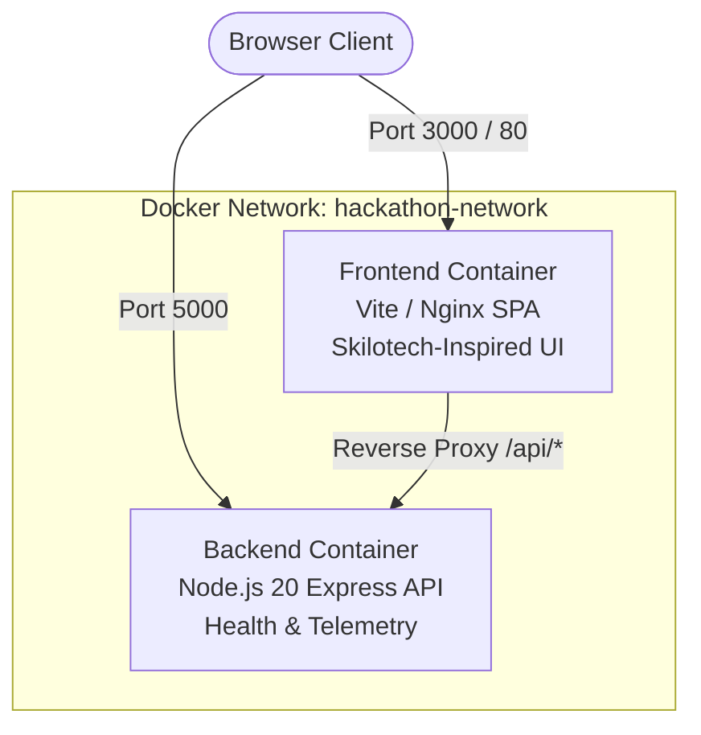

# 🚀 DebugMate — Interactive Code Debugging & Practice Platform

A production-grade, containerized full-stack application. Features an Express.js REST API backend, a Vite + React frontend styled with modern responsive UI (floating island navbar, ambient mesh glows, interactive IDE), and a deliberate debugging lab with Java/JS parity, progressive hints, and cognitive explanation gates.

---

## 🏗️ Architecture Overview



### Services Summary

| Service | Technology | Port (Host : Container) | Purpose |
| :--- | :--- | :--- | :--- |
| **`frontend`** | React 18 + Vite + Nginx | `3000:80` (Prod) / `5173:5173` (Dev) | Skilotech-Inspired Debugging Sandbox & Telemetry Dashboard |
| **`backend`** | Node.js 20 Alpine + Express | `5000:5000` | REST API, Health Probes & Demo CRUD Endpoints |

---

## 🚀 Quickstart with Docker

### Prerequisites
Make sure **Docker Desktop** is installed and running on your system ([Download Docker Desktop](https://www.docker.com/products/docker-desktop/)).

### 1. Run Production Stack (Orchestrated)
Build and launch all containers in detached mode:
```bash
docker compose up --build -d
```
- **Frontend App**: Open [http://localhost:3000](http://localhost:3000)
- **Backend API**: Open [http://localhost:5000](http://localhost:5000)
- **Health Check**: Open [http://localhost:5000/api/health](http://localhost:5000/api/health)

### 2. Run Development Stack (Hot-Reload Enabled)
Mounts source code into containers so edits immediately reload without rebuilding:
```bash
docker compose -f docker-compose.dev.yml up --build
```
- **Frontend with Vite HMR**: Open [http://localhost:5173](http://localhost:5173)
- **Backend with Nodemon**: Open [http://localhost:5000](http://localhost:5000)

### 3. View Logs & Stop Stack
```bash
# Stream logs from all services
docker compose logs -f

# Stream logs from backend only
docker compose logs -f backend

# Stop all containers and clean network
docker compose down
```

---

## 💻 Running Locally (Without Docker)

You can run both the frontend and backend directly on your host machine using Node.js:

### 1. Install Dependencies
```bash
npm install
npm run install:all
```

### 2. Start Both Services Together (Recommended)
Run both backend and frontend concurrently in a single terminal:
```bash
npm run dev
```
- **Frontend App**: Open [http://localhost:5173](http://localhost:5173)
- **Backend API**: Running at [http://localhost:5000](http://localhost:5000)
- **Health Check**: Open [http://localhost:5000/api/health](http://localhost:5000/api/health)

*(Optional)* Or run them independently in separate terminals:
- **Terminal 1 (Backend)**: `npm run dev:backend`
- **Terminal 2 (Frontend)**: `npm run dev:frontend`

---

## 🛡️ Docker Integration Highlights

### 1. Backend Container ([`backend/Dockerfile`](file:///backend/Dockerfile))
- **Base Image**: `node:20-alpine` (lightweight, minimal attack surface).
- **Security**: Runs under unprivileged `node` user instead of root.
- **Layer Caching**: Copies `package.json` first to avoid re-installing dependencies on code changes.
- **Healthcheck**: Automated Docker health probe against `/api/health`.

### 2. Frontend Container ([`frontend/Dockerfile`](file:///frontend/Dockerfile))
- **Multi-Stage Build**:
  - **Stage 1 (Builder)**: Compiles React app with Vite.
  - **Stage 2 (Runner)**: Serves static assets via high-performance `nginx:alpine` image.
- **SPA Routing & Reverse Proxy**: [`frontend/nginx.conf`](file:///frontend/nginx.conf) routes client-side pages and proxies `/api/*` requests seamlessly to the backend container.

### 3. Docker Compose Orchestration ([`docker-compose.yml`](file:///docker-compose.yml))
- Isolated bridge network (`hackathon-network`).
- Health check dependency: `frontend` waits until `backend` reports healthy before starting.
- Standardized environment variables via `.env.example`.

---

## 📡 API Endpoints

| Method | Endpoint | Description |
| :--- | :--- | :--- |
| `GET` | `/` | API status and route index |
| `GET` | `/api/health` | Container health, uptime, and memory usage metrics |
| `GET` | `/api/info` | Hostname, container mode, OS architecture, and CPU count |
| `GET` | `/api/items` | Retrieve list of demo hackathon items |
| `POST` | `/api/items` | Add a new item (`{ "title": "...", "category": "..." }`) |
| `DELETE` | `/api/items/:id` | Delete an item by ID |

---

## 📂 Project Directory Structure

```text
.
├── .dockerignore              # Global Docker ignore rules
---

## 🔐 Google OAuth 2.0 & Authentication System

CodeQuest AI supports dual authentication methods:
1. **Google OAuth 2.0 / Google Identity Services (GIS)**:
   - Modern, official 1-click **Continue with Google** button.
   - Supports Google Identity Services (GIS) ID Token verification via Google's `tokeninfo` API endpoint.
   - Supports full server-side OAuth 2.0 authorization code flow via `GET /api/auth/google` and `GET /api/auth/google/callback`.
   - **Evaluator & Sandbox Mode**: When testing locally without Google Cloud Console credentials, the app provides a built-in, interactive **Google Account Chooser** modal with realistic sample profiles (Learner, Mentor, or custom Google email) so hackathon judges can test the full Google authentication lifecycle immediately without any configuration blocker!
2. **Standard Email & Demo Credentials**:
   - 1-click demo logins (`learner@dypatil.edu` and `mentor@dypatil.edu`).
   - Account registration with role assignment (Learner vs Lead Reviewer).

### Configuring Real Google OAuth Credentials:
In your `.env` file (server-side only, never expose client secrets):
```env
GOOGLE_CLIENT_ID=your-id.apps.googleusercontent.com
GOOGLE_CLIENT_SECRET=your-secret
GOOGLE_CALLBACK_URL=http://localhost:5000/api/auth/google/callback
VITE_GOOGLE_CLIENT_ID=your-id.apps.googleusercontent.com
```

---

├── .gitignore                # Git ignore rules
├── .env.example              # Environment variables template
├── docker-compose.yml        # Production Docker Compose orchestration
├── docker-compose.dev.yml    # Development Docker Compose with live reloading
├── package.json              # Root orchestration scripts
├── readme.md                 # Project documentation
│
├── backend/                  # Express.js REST API
│   ├── .dockerignore
│   ├── .env.example
│   ├── Dockerfile            # Production Alpine image
│   ├── Dockerfile.dev        # Development hot-reload image
│   ├── package.json
│   └── src/
│       └── index.js          # Server entrypoint & API routes
│
└── frontend/                 # Vite + React Client
    ├── .dockerignore
    ├── .env.example
    ├── Dockerfile            # Multi-stage production build (Nginx)
    ├── Dockerfile.dev        # Development HMR container
    ├── nginx.conf            # Nginx reverse proxy & SPA config
    ├── package.json
    ├── vite.config.js        # Vite config with Docker polling & proxy
    ├── index.html
    └── src/
        ├── App.jsx           # Main UI dashboard
        ├── main.jsx          # React DOM entrypoint
        ├── index.css         # Dark-mode glassmorphic styling
        ├── pages/
        │   ├── PracticePage.jsx # Dedicated IDE & debugging sandbox
        │   └── LoginPage.jsx    # Authentication & telemetry profile
        └── components/
            ├── Navbar.jsx
            ├── HeroSection.jsx
            ├── MissionsSection.jsx
            ├── ShowcaseBrowser.jsx
            ├── InteractiveJourney.jsx
            ├── BentoGrid.jsx
            └── DockerGuideCard.jsx
```